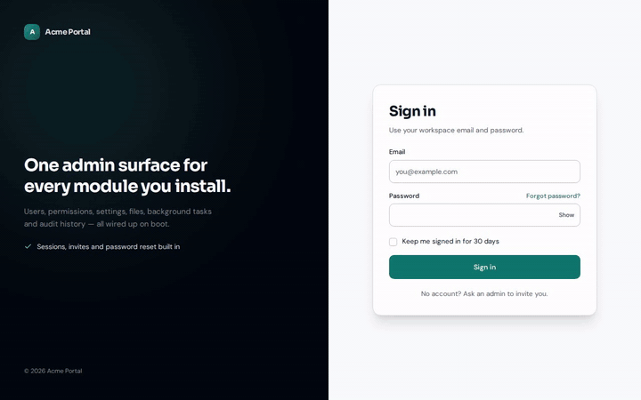

# simple_module_python

A modular-monolith framework for Python. Each feature lives in its own self-contained module, with its own SQLModel tables, FastAPI endpoints and React pages, but everything ships as one FastAPI + Inertia.js + React app. No microservice tax, no API-client glue: plugin modules that compose at boot.



## Stack

- **Backend:** Python 3.12, FastAPI, SQLModel (SQLAlchemy async + Pydantic), Alembic
- **Frontend:** Inertia.js v3 + React + Tailwind CSS 4, Vite HMR
- **UI:** shadcn/ui primitives + emerald/teal design tokens, Sora display font, DM Sans body, JetBrains Mono code
- **Auth:** pluggable providers: local users (email + password, OAuth/OIDC sign-in with Google, GitHub, Microsoft/Entra) via fastapi-users, Keycloak OIDC SSO, or any OIDC provider (Microsoft Entra, Auth0, Okta, Keycloak) via the generic `oidc` module; cookie sessions or bearer tokens
- **Tooling:** uv workspaces, npm workspaces, Ruff, ty, Biome, pytest, Vitest, Playwright

## Build an app

To **build an app on simple_module** rather than work on the framework itself:

```bash
uvx --from simple_module_cli@latest smpy new my-app
cd my-app
make dev
```

`@latest` matters: without it `uvx` reuses an `smpy` you installed earlier with `uv tool install`, and an older CLI scaffolds an app pinned to its own, older framework version. `smpy new` warns when PyPI has a newer CLI.

`smpy new` scaffolds the app, installs it and runs the first migration. The default `standard` preset wires `auth`, `users`, `dashboard` and `permissions`; `--preset minimal` keeps only users, `--preset full` adds settings, feature flags, file storage, background tasks and site lock, and `--with background_tasks,file_storage` adds single modules. Until an admin exists, every page redirects to the `/setup` wizard, which creates one; after that you sign in at `/users/login`.

Inside the app, use its own CLI with `uv run smpy …`:

| Command | What it does |
|---|---|
| `uv run smpy add <spec>` | Add a module from PyPI, a `git+` URL or a local path |
| `uv run smpy create-module <name>` | Scaffold a module; wire and install it inside an app workspace |
| `uv run smpy update` | Update PyPI/git framework and module pins, sync lockfiles and generate |
| `uv run smpy users create-admin` | Create (or with `--force`, reset) an admin |
| `uv run smpy doctor` | Check installed modules and database compatibility |
| `uv run smpy skills add` | Install the agent skills for this framework into the project |

The [quickstart](docs/guide/quickstart.md) walks through the first module. See [CHANGELOG.md](CHANGELOG.md) for the published PyPI / npm packages at each release.

## Bundled modules

| Module | What it does |
|---|---|
| `auth` | Session-cookie auth primitives (middleware, login/logout, redirects); every provider builds on it |
| `users` | Local accounts: password login, invites, signup, roles, OAuth, admin UI. The default auth provider |
| `keycloak` | Keycloak OIDC auth provider |
| `oidc` | Generic OIDC auth provider (Microsoft Entra, Auth0, Okta, Keycloak, …) |
| `permissions` | Role-based permissions and their admin UI |
| `api_tokens` | Personal access tokens and service API keys |
| `tenants` | Organisations, memberships and tenant resolution for multi-tenant installs |
| `dashboard` | Authenticated home and the `/admin/doctor/` diagnostics panel |
| `settings` | Admin settings UI for DB-backed settings, and `smpy settings` |
| `feature_flags` | Feature flags with per-tenant overrides |
| `file_storage` | Uploads to the local filesystem or S3 |
| `background_tasks` | Celery + Redis task queue, durable event outbox, admin monitoring UI |
| `mail` | Outgoing mail (SMTP or console) |
| `audit_log` | Field-level audit trail for SQLModel entities |
| `branding` | App name, logo, favicon and primary colour |
| `sharing` | Generic resource shares between users |
| `site_lock` | Site-wide password gate for staging and pre-launch |

Each has a page under [docs/modules/](docs/modules/index.md).

## Work on the framework

```bash
make install       # uv sync --all-packages + npm install
make migrate       # Alembic upgrade heads on ./app.db (SQLite, the default)
make dev           # shared Docker stack + gen-pages + API (:8000) and Vite (:5050)
```

No `.env` is needed: the defaults use SQLite, and `.env.example` lists what you can override. `make dev` first starts the author's shared Postgres/Redis stack from a sibling `../dev-services` checkout. Without it, run `make gen-pages`, then `make dev-api` and `make dev-ui` in two terminals.

Open `http://localhost:8000`. The first visit goes to the `/setup` wizard until an admin exists (or create one with `uv run smpy users create-admin --email admin@example.com`). Then `/users/login` signs you in, `/dashboard/` is the authenticated home, `/admin` the admin section, and `/admin/doctor/` the diagnostics panel.

## Run it in Docker

The repo ships a default image (`./Dockerfile`) that builds the host plus every
bundled module (Python workspace, `gen-pages`, and the production Vite bundle)
and serves it with uvicorn. It is standalone: SQLite lives inside the container
under `/app/data`, so no Postgres and no Redis are needed to boot.

```bash
make docker-app        # build ./Dockerfile, then run it on http://localhost:8000
```

`make docker-app` and `make docker-compose-app` both take `SM_APP_PORT=8010`
when a `make dev` already holds 8000. Without make:

```bash
docker build -t simple-module-python .
docker run --rm -p 8000:8000 -v simple-module-python-data:/app/data simple-module-python
```

**Logging in.** With no `SM_USERS_BOOTSTRAP_PASSWORD` set, the container seeds
`admin@example.com` with a randomly generated password. The users module logs it
once when the first admin is created:

```
first-boot admin created; store this password securely: admin@example.com / <generated password>
```

Read it with `docker logs`. Pass `-e SM_USERS_BOOTSTRAP_EMAIL=… -e SM_USERS_BOOTSTRAP_PASSWORD=…`
to seed your own instead; an explicit `changeme` is refused because the image runs
with `SM_ENVIRONMENT=production`. The seed only applies while the users table is
empty, so on a reused volume the existing password still stands and no credentials
are logged. Reset it with
`smpy users create-admin --email … --password … --force`.

`make docker-compose-app` (or `docker compose up --build app`) runs the same
image through compose with a named volume, independent of the shared
dev-services stack that `worker`/`beat` use.

Before uvicorn binds, the entrypoint applies `alembic upgrade heads` (a fresh
volume has no tables, and production fails boot on `SM010` when the DB is behind
head). With `SM_SECRET_KEY` unset, the host then generates a key once and persists
it in the DB, so sessions survive restarts. Only an unset pre-migration boot uses
an ephemeral key until migrations make persistence possible.

The image runs with `SM_ENVIRONMENT=production` because it serves the built
bundle rather than a Vite dev server. Useful overrides:

| Variable | Image default | Why you'd change it |
|---|---|---|
| `SM_SECRET_KEY` | generated once and persisted in the DB | Pin the key yourself |
| `SM_DATABASE_URL` | `sqlite+aiosqlite:////app/data/app.db` | Point at Postgres |
| `SM_USERS_BOOTSTRAP_EMAIL` / `_PASSWORD` | `admin@example.com` / generated and logged | Seed a first admin with a password you chose |
| `SM_TRUSTED_PROXY` | unset | Set to `*` behind a reverse proxy, so logs record the visitor's IP and not the proxy's |

**No background tasks.** The image skips installing the Celery module
(`uv sync … --no-install-package simple-module-background-tasks`), so nothing in
it wants a broker: a queue means a second process and a Redis, which is the
opposite of a standalone image. `docker-compose.yml`'s `worker` / `beat`
services cover that path: they build `docker/worker.Dockerfile` against the
shared `../dev-services` Postgres + Redis on the external `devnet` network. To
run tasks from the web process instead, drop the `--no-install-package` flag
from the Dockerfile and set `SM_REDIS_URL`.

## Create a new module

```bash
make new-module name=orders
```

That scaffolds `modules/orders/` with a working CRUD module: `ModuleMeta`, a SQLModel table with `AuditMixin`, SQLModel contracts, a service layer, REST + Inertia view endpoints, `Browse/Create/Edit.tsx` pages, translations and tests. It also wires the module into the workspace and regenerates the i18n keys and typed API client. Next:

```bash
# 1. Edit modules/orders/orders/models.py to your actual schema
# 2. Generate the module's first migration on its own branch; set
#    branch_labels = ("orders",) in the new revision
make migration LABEL=orders msg="add orders tables"
# 3. Apply it and run the tests
make migrate
make test
```

The migration history has several heads, so `make migration` always names a branch with `LABEL`. [Module authoring](docs/module-authoring.md) covers the first revision and how to review one autogenerated on SQLite.

The new module is discovered through its Python entry point; its routes register at `/api/orders` and `/orders`, and its menu entry appears in the sidebar.

## Project layout

```
framework/
  core/        # module system, discovery, events, diagnostics
  db/          # per-module Base, sessions, mixins, tenancy, migration helpers
  hosting/     # create_app, middleware, settings, setup wizard, /admin
  inertia/     # Inertia.js v3 server adapter
  testing/     # pytest plugin with shared fixtures and helpers
  cli/         # smpy: new, add, update, create-module, skills, openapi, ...
modules/       # the 17 bundled plugin modules
host/          # the dev host app: main.py, client_app/ (Vite + React), all Alembic migrations
packages/
  ui/          # shared shadcn/ui components, layouts, design tokens
  i18n/        # generated i18n keys + translation runtime
  tsconfig/    # shared TypeScript config
skills/        # agent skills shipped to users (smpy skills add)
tests/         # e2e (Playwright), perf, integration and load tests
scripts/       # generators and the CI checks behind make lint
docker/        # entrypoint and worker image
docs/          # VitePress site: guide, framework, database, frontend, testing, modules, reference
```

## Common commands

| Command | What it does |
|---|---|
| `make install` | Install Python (`uv sync --all-packages`) and JS (`npm install`) deps, then run `smpy gen` |
| `make dev` | Shared Docker stack + `smpy dev`: generation, API (:8000) and Vite (first free port from 5050) |
| `make dev-api` / `make dev-ui` | Just the API (:8000, reloads on `.py` and locale changes) / just Vite (:5050) |
| `make test` | `make test-py` (pytest, parallel) then `make test-js` (Vitest) |
| `make test-py-pg` | The pytest suite on Postgres |
| `make test-e2e` | Playwright smoke tests against a running `make dev` |
| `make lint` | Every CI lint check: Ruff, ty, Biome, tsc, file-size cap, translations, generated-file freshness, doc paths and more |
| `make doctor` | Module diagnostics (`SM0xx`): orphan pages, render mismatches, coupling, migration drift, locale drift, … |
| `make migrate` | Apply pending Alembic migrations (`upgrade heads`) |
| `make migration LABEL=<label> msg="..."` | Autogenerate a migration on one branch of the history |
| `make gen` | Incrementally prepare pages, i18n keys, module JS dependencies and API types |
| `make gen-pages` / `gen-i18n` / `gen-api-types` | Regenerate the page manifest / i18n keys / typed API clients |
| `make new-module name=<name>` | Scaffold a new module |
| `make worker` / `make beat` | Celery worker / beat for `background_tasks` |
| `make kill` | Print stop guidance: Ctrl-C or SIGTERM the `smpy dev` supervisor to clean up its children |
| `make docker-build` / `docker-app` | Build the default app image / run it standalone on port 8000 |
| `make docker-up` / `docker-down` | `docker-up` brings up the shared dev-services stack (Postgres/Redis/MinIO); `docker-down` stops only this repo's worker/beat (SQLite needs no Docker) |

## Configuration

Configuration lives in the database and is edited in the admin UI at `/admin/settings/`. A local run needs no env var at all.

| Variable | Default | Notes |
|---|---|---|
| `SM_DATABASE_URL` | `sqlite+aiosqlite:///./app.db` | Async URL. Postgres: `postgresql+asyncpg://...` |
| `SM_ENVIRONMENT` | `development` | Any value other than `development` turns on strict discovery; any other than `development`/`testing` also refuses the placeholder secret |
| `SM_SECRET_KEY` | unset: generated once and stored in the DB | Set it to pin the key yourself; a placeholder value is refused in production |
| `SM_REDIS_URL` | unset | Seeds the Celery broker and result backend, and the shared rate-limit store |
| `SM_VITE_DEV_URL` | `http://localhost:5050` | Dev only: Vite HMR origin |
| `SM_DEBUG`, `SM_MODULES_ENABLED` | off / every installed module | Process wiring read before the DB opens |
| `SM_USERS_BOOTSTRAP_EMAIL` / `_PASSWORD` | unset | Seed the first admin on an empty users table |

Host settings such as `SM_AUTH_PROVIDER`, the DB pool, logging, `SM_TRUSTED_PROXY` and the i18n locales are DB-backed; an env var still wins over the stored value, so existing deployments keep their behaviour. To copy your current environment (and `.env`) into the settings store once:

```bash
uv run smpy settings import-from-env
```

Every variable is listed in [the env-var reference](docs/reference/env-vars.md).

## UI & design system

The frontend uses an emerald + teal design system mirrored as Tailwind 4 tokens. Module pages compose from a small set of shared primitives so they stay visually consistent without duplication.

**Shared primitives** (in `packages/ui/src/`):

| Component | When to use |
|---|---|
| `PageShell` | Every authenticated page. Wraps title + description + actions header and a max-width content area. |
| `StatCard` | Top-of-page KPI tiles: icon, value, label, optional delta badge. Used on Dashboard, Users, Doctor. |
| `SectionTitle` | Card section headings with the gradient accent bar. |
| `FilterPills` | Segmented filter chips for status/tab-style toggles. |
| `AuthCardShell` | Login / register / forgot / accept-invite / verify: light glass card on emerald mesh blobs. |
| `ErrorScreen` | 403 / 404 / 500: gradient HTTP numerals + accent badge per status. |

**Design tokens** live in `packages/ui/src/styles/globals.css` under the `@theme` block: primary emerald scale (`--color-primary-50…900`), display/sans/mono families, semantic shadcn tokens. Override the CSS variables (or use the `branding` module) to rebrand without touching component code.

**Module pages** should:

- Wrap in `PageShell` with `title`, optional `description`, and `actions`.
- Use `Card` + `CardContent` from `@simple-module-py/ui/components/ui/card` for content blocks.
- Reach for `StatCard` / `SectionTitle` / `FilterPills` before rolling new layouts.
- Use lucide-react icons and the existing `Badge` / `Button` variants: emerald primary for the main CTA, outline / ghost for secondary actions.
- Put every user-visible string through `t(keys.<ns>.…)`; CI fails on untranslated literals.

The 300-line file cap (enforced by CI) usually pushes you to factor row-level components out; see `modules/users/users/admin/components/UserRow.tsx` and `modules/dashboard/dashboard/ui/components/doctor/report.ts` for the pattern.

## User management

### Auth providers: exactly one is active

This repo ships three authentication providers, and **exactly one can be active at a time**:

| Module | What it does |
|---|---|
| `users` (default) | Local accounts: password login, invites, signup, roles, an admin UI |
| `keycloak` | Delegates authentication to a Keycloak realm over OIDC |
| `oidc` | Delegates authentication to any OIDC provider (Entra preset; Keycloak via the generic preset); see [docs/modules/oidc.md](docs/modules/oidc.md) |

They all claim the same slot, so running two together is a misconfiguration, not a
supported combination. More than one active provider is reported as `SM020`
(error, fails boot); none installed is `SM021` (warning).

`uv sync --all-packages` installs *every* workspace member, so a dev clone has every
provider on disk. The host therefore activates one and skips the others, and **`users`
is the default**: `keycloak` and `oidc` are installed but inert until you select one.
To switch, set the auth provider host setting in `/admin/settings/`, or in `.env`:

```bash
SM_AUTH_PROVIDER=keycloak
```

Then restart and re-run `make gen-pages` so the frontend manifest picks up the active
provider's pages (`make dev` does this for you), and configure the provider under
`/admin/settings/`. Switching back is the same setting set to `users`.

With Keycloak or OIDC active:

- `permissions` works with Users, OIDC and Keycloak through the neutral role
  directory. Users is only an optional ordering dependency of Permissions, so
  local-account machinery is not required for role mappings or direct grants.
- The local-account flows (`/users/login`, invites, signup, the sections below)
  belong to the `users` module and are gone; the identity provider owns login,
  logout and user administration instead.

A host that ships only `keycloak` (or only `oidc`) keeps it regardless of `SM_AUTH_PROVIDER`.

### Creating the first admin

Use the `/setup` wizard on first visit, or the CLI:

```bash
uv run smpy users create-admin --email admin@example.com
```

Or let the app bootstrap it on first boot by setting env vars **before** running `make migrate && make dev`:

```
SM_USERS_BOOTSTRAP_EMAIL=admin@example.com
SM_USERS_BOOTSTRAP_PASSWORD=changeme
```

The auto-bootstrap is idempotent: it only creates the user if the `users_user` table is empty.

### Inviting users

1. Log in as admin and navigate to `/admin/users/add`.
2. Fill in the invitee's email and optionally a full name and role(s). Click **Send invite**.
3. Without SMTP configured, the invite link is logged to stdout (`tail -f` the server log). Copy the link and send it to the user. With SMTP, the email is delivered.
4. The invitee opens the link (`/users/invite/accept?token=…`), sets a password, and is immediately logged in.

### Enabling public signup

Turn on **Allow signup** in the Users settings at `/admin/settings/`; the `/users/register` page opens on the next request, no restart needed. (The users module no longer reads `SM_USERS_ALLOW_SIGNUP`; `smpy settings import-from-env` copies an old value into the store once.)

### Switching to SMTP

Outgoing mail is configured in the `mail` module (admin UI at `/admin/settings/`, under Mail), not through `SM_USERS_*` variables. Blank `users.base_url` (the default) inherits `host.public_base_url`; an explicit Users origin overrides it. Set the host origin in Settings or through `SM_PUBLIC_BASE_URL`. When both origins are blank, copied links remain relative and account emails are skipped with an ERROR log naming the setting to configure. Public reset and verification responses stay the same for existing and unknown addresses. The users module no longer reads `SM_USERS_BASE_URL`.

## Architecture

- **Modules**: discovered via Python entry points at boot and ordered by their declared dependencies. Each module subclasses `ModuleBase` and opts into the lifecycle hooks it needs (`register_routes`, `register_menu_items`, `register_permissions`, `register_middleware`, `on_startup`, …). See [lifecycle](docs/framework/lifecycle.md).
- **Database**: a single shared schema on both Postgres and SQLite. Each module owns its own `MetaData` (so Alembic can attribute tables to it), and `__tablename__` is prefixed with the module name (`orders_order`). Models with the soft-delete or tenant mixins are filtered on every query.
- **Middleware**: proxy headers → correlation id → request logging → CORS → body limit → GZip → security headers → session → Inertia → module middleware → tenant → locale → layout data → rate limit → setup gate → maintenance → commit-before-response. Full order and rules in [middleware](docs/framework/middleware.md).
- **Diagnostics**: `make doctor` runs static checks over installed modules: orphan pages and phantom renders, framework→plugin coupling, migration drift, locale drift, auth-provider exclusivity, unguarded API routes and more ([diagnostic codes](docs/reference/diagnostic-codes.md)). Production runs only the checks that must fail a boot.
- **Internationalization**: per-module `locales/<lang>.json` files merged at boot. The frontend uses `i18next` with generated, type-safe keys; the backend uses Babel for CLDR plurals. The locale is resolved per request from the cookie, then `Accept-Language`, then the default locale.

Full documentation lives in [`docs/`](docs/index.md), a VitePress site covering the guide, framework internals, database, frontend, testing, every bundled module, and reference. When conventions are ambiguous, these single-pagers are the source of truth:

- [Framework conventions](docs/framework-conventions.md)
- [Module authoring](docs/module-authoring.md)
- [E2E testing](docs/e2e-testing.md)
- [Release playbook](docs/release.md)

Historical, point-in-time design docs live under [`docs/plans/`](docs/plans/) and [`docs/superpowers/`](docs/superpowers/).

## Contributing

- Read [AGENTS.md](AGENTS.md): the conventions, commands and checks for this repo, written for coding agents and useful for humans too. Claude Code loads it through `CLAUDE.md`.
- Write tests with the fixtures from the `simple_module_test` plugin (`db_session`, `authenticated_client`, …).
- Run `make lint` and `make test` before pushing; `make lint` runs every CI lint check locally.
- Add a `## [Unreleased]` entry to `CHANGELOG.md` for user-visible changes.

### For AI agents in your app

Apps built on simple_module can install this framework's agent skills (module authoring, migrations, testing, page performance, …) in the Agent Skills format used by Claude Code, Codex and others:

```bash
uv run smpy skills add
```

They go to `./.claude/skills` by default; `--dest <dir>` installs them where another agent looks, and `-g` installs them for your user. The skills live in [`skills/`](skills/README.md).
